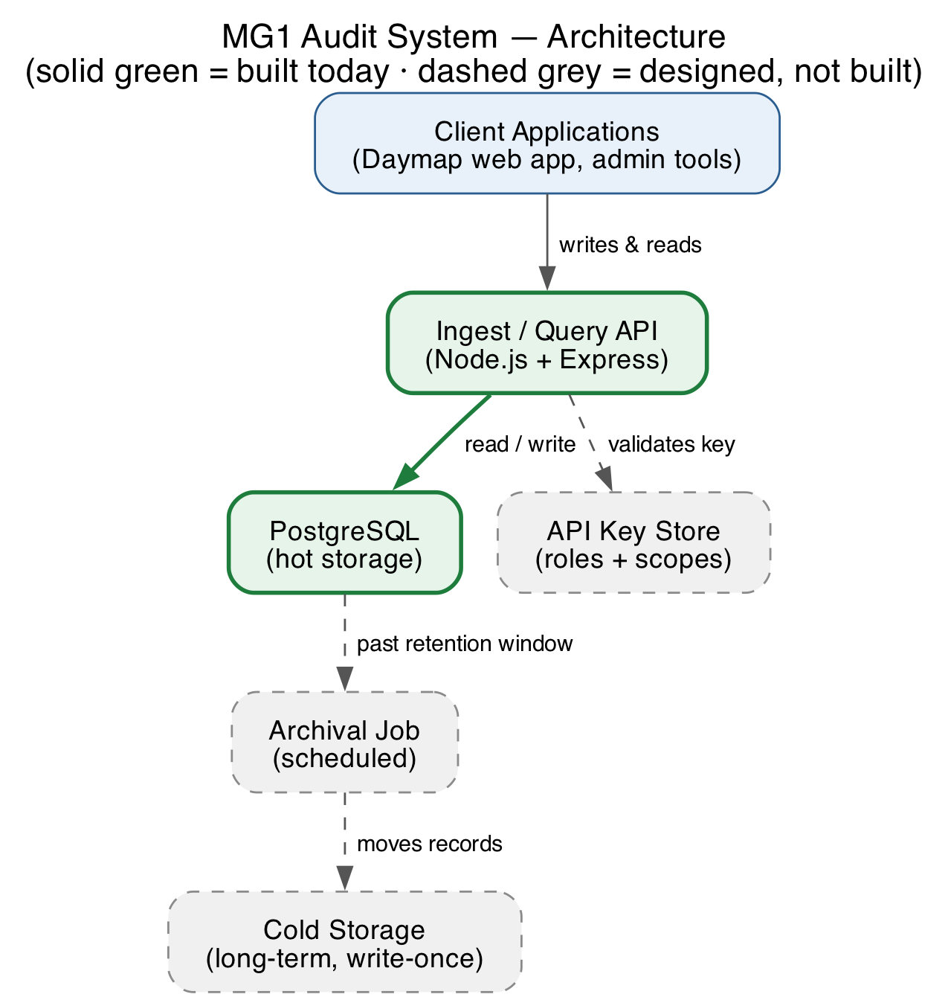

# MG1: Web Application Audit System — Project Plan & Architecture

Prepared for Harry Macheda (Civica/Daymap) by the MG1 team: Saichetan, Vishnu, Rahul, Indra, Surbhi, Nivil, Basil.

## 1. Project Overview

Daymap needs a way to keep a reliable record of who accessed or changed sensitive data across its school-management platform, so that if a compliance investigation ever comes up, there's an accurate history to look back on. We're building that record-keeping system as a standalone service: other Daymap systems will send it events over a REST API, and it will store and serve that history back on request.

This document sets out the architecture we've decided on, what's already built and working, and our plan for delivering the rest over the coming weeks.

## 2. Requirements

A typical query returns anywhere from a few hundred to a few thousand records, occasionally up to the hundreds of thousands. Jurisdiction and school code are drawn from a fixed list in production but can be treated as plain free text for this project. Audit records will regularly include details about the user involved and about the data being accessed. Once data is archived, it doesn't need to be readable through the API again. No cloud deployment is required this semester — a local setup is sufficient. API access is controlled through keys with different permission levels. Priority is on getting the design and architecture right, backed by a real, working API against at least one datastore.

## 3. Architecture

The system is five pieces. Two are built and running today; the rest are designed and agreed, with a scheduled plan to build them.



**The ingest/query API** is the only thing other systems talk to. It checks incoming requests, validates the required fields, and either writes a new record or answers a query.

**Hot storage**, a PostgreSQL database, is where recent records live and where all the searching happens. It's indexed on the fields most likely to be searched.

**The API key store** will hold hashed keys in Postgres, each with a role and a set of allowed jurisdictions/schools, checked by a middleware layer before any request is processed.

**The archival job** will run on its own schedule, separate from the API, and move anything past a configurable age out of hot storage.

**Cold storage** is where that older data ends up — cheap, long-term, and never read back through the API once it's there.

### How a request moves through the system today

A client sends a write request with a date, jurisdiction, and school code, plus whatever else it wants to include. The API checks those three required fields are present and inserts the record straight into Postgres. A read request comes back through the same API, and pagination is snapshot-consistent — the first page of a query fixes a point in time, and later pages of that same query stay locked to it, so a burst of new writes partway through paging never causes records to be skipped or duplicated.

Once auth and the archival pipeline are in place, every request will also carry an API key, validated against the key store before anything else runs, and the archival job will quietly move aged-out records to cold storage in the background.

### Scope for this semester

A fuller cloud-native version of this — built around Azure API Management, Event Hubs, Stream Analytics, and similar services — is a reasonable direction for full production scale later. Since no cloud deployment is required this semester, we're focused on the leaner design above: something we can build, run locally, and demonstrate working end to end.

## 4. Technology Choices

We're building this in **Node.js and TypeScript**. The workload here is mostly a high volume of small, simple requests rather than heavy computation, which is exactly what Node handles well, and TypeScript catches a lot of mistakes before code even runs. For the API layer we're using **Express**, which is minimal and stays out of the way. Data lives in **PostgreSQL**, which handles this kind of filtered, indexed querying comfortably and has no licensing cost. We're using **Prisma** to talk to the database, which keeps queries type-safe and handles migrations. For cold storage, we're starting with plain files on disk, designed so that moving to Azure Blob Storage later is a small change rather than a rewrite. Everything runs locally through **Docker Compose**, so the whole system comes up with one command on any machine.

## 5. Data Model

```prisma
model Entry {
  id           String   @id @default(uuid())
  sequence     Int      @unique @default(autoincrement())
  date         DateTime
  jurisdiction String
  schoolCode   String
  userId       String?
  extra        Json     @default("{}")
  createdAt    DateTime @default(now())

  @@index([jurisdiction, schoolCode, date])
  @@index([userId])
}
```

`date`, `jurisdiction`, and `schoolCode` are the required fields. `userId` also gets its own indexed column, since user details show up in almost every entry in practice and "what did this person access" is a natural, frequent question. Everything else — username, what kind of resource was touched, its name and ID, and anything added in future — goes into a flexible `extra` field, indexed so it can still be searched without a schema change every time something new comes up.

## 6. API Endpoints

`POST /entries` accepts a single record or an array of them, and is working today. `GET /entries` queries the history, filtering by jurisdiction, school, user, date range, or any arbitrary field, and is also working today. `POST /api-keys` and `DELETE /api-keys/:id`, for creating and revoking keys, are designed and scheduled next.

## 7. What's Working Today

Writing and querying entries both work against a real local Postgres database, including validation that rejects a record missing any required field. Filtering works across every field mentioned above, including arbitrary ones. Snapshot-consistent pagination is built and proven by an automated test, not just assumed to work. There's also a small visual dashboard for writing and browsing entries directly. Everything currently passes our test suite (11 tests) along with type-checking and linting.

## 8. Delivery Plan

We're using a 9-week structure: architecture first, then a working API against one datastore, then archival, then load testing and polish.

Weeks 1 and 2 covered agreeing the architecture and setting up the repo and dev environment — both done. Weeks 3 and 4 were the write and read endpoints, including pagination — also done. Week 5 is API keys and permissions. Week 6 is broader integration testing and sample data, alongside a mid-project check-in. Week 7 is the archival job and cold storage. Week 8 is load testing against expected query volumes, plus basic logging. Week 9 wraps up documentation, deployment instructions, and the final demo.

## 9. Open Questions

A few things would help us finalise the remaining work:

1. What retention period should trigger moving data from hot to cold storage — 30 days, 90 days, something else?
2. Do we need more than read/write permissions — for example, access scoped to a specific jurisdiction, or admin-only key management?
3. Could Civica share a small sample of real audit data, or should we generate our own?
4. Is the "action" field (view, create, update, delete) a fixed list, or free text like jurisdiction and school code?
5. Should a single query filter across multiple jurisdictions or schools at once, or is it always scoped to one?
6. Is there an expected response time for queries, particularly the larger ones?
7. Who's expected to create API keys day to day — end users, or only administrators?
8. How will this be assessed at the end of semester — the architecture document, the working demo, or both?
9. What's the best way to keep you updated as we go — regular check-ins, or as-needed?

## 10. Who's Doing What

**Vishnu and Rahul** are taking API keys and authentication: designing the key table, building the endpoints to create and revoke keys, and writing the middleware that checks every request against a caller's role and allowed jurisdictions.

**Indra and Surbhi** are taking the archival job: working out how the retention window gets configured, building the scheduled process that moves old records out of Postgres, and writing it to disk as cold storage.

**Nivil** is putting together realistic sample data and expanding integration tests to cover combinations of filters and edge cases.

**Basil** is handling load testing — pushing the write endpoint under a realistic burst of traffic and adding basic logging.

**Saichetan** is coordinating across the team, keeping this document current, and owns the final documentation and demo in week 9.

## 11. Assumptions

Whether sample data is generated by the team or supplied by Civica, the exact retention period before archival, and the specific permission scopes needed are all still to be confirmed. The fuller Azure-based architecture remains a reasonable long-term direction if this ever needs to run at full production scale, but isn't part of what's being delivered this semester.
